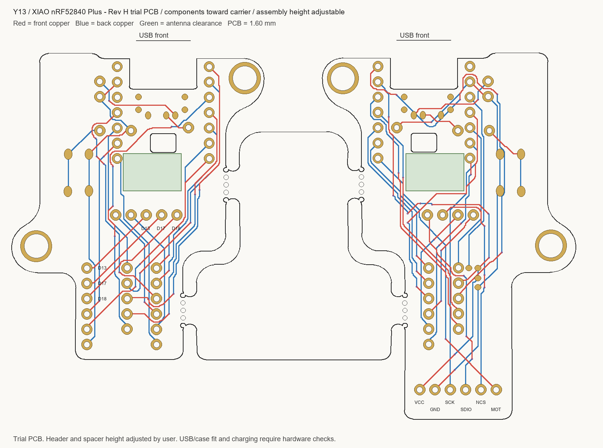

# Rev H 試作基板

**発注用：[Y13-XIAO-revH-order-gerbers.zip](Y13-XIAO-revH-order-gerbers.zip?raw=true)**

2層・FR-4・板厚 **1.6 mm**。XIAO nRF52840 Plusの**部品面をキャリアへ向ける**取付けです。Rev G以前のGerberは使用しないでください。

支持部材と取付高さはユーザーが実物で調整する前提の試作用データです。基板間隔4.7 mmは参考値で、確定寸法ではありません。ケース適合、電池保護・充電条件、実機動作は未検証です。

- [発注・組立メモ](assembly-and-order.md)
- [XIAOとキャリアのピン接続表](pin-connections.csv)
- [DRC結果](drc.txt)：違反0、未配線0
- [Gerber・穴データ検証](verification.json)：PTH150点、NPTH12点を基板データと照合済み

左4×6＋5＝29キー、右4×6＋3＝27キー＋トラックボールに対応。右が親機。予備GPIO3本は左側にあります。

同じリポジトリのXIAO用ファームウェアは信号割当を維持しています。UF2名のrevGは既存ビルドの名前で、旧Rev G PCBの取付向きを推奨するものではありません。Rev Hでの実機動作は未検証です。
